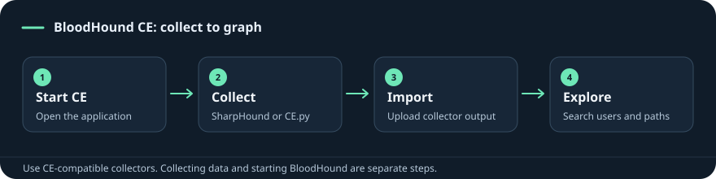

{/* Generated from Commands/bloodhound.md. Edit the Markdown source, then run scripts/sync_site.py. */}

## Collect, import and validate a path

BloodHound's graph is a map of collected relationships. Begin with the identity you actually control and a specific destination, then inspect each edge's meaning and prerequisites. A graph path is a hypothesis until the current directory/host confirms it.

### Start the application separately from collection

```bash
# Kali packaging that provides this launcher:
sudo bloodhound-start
```

Use the URL printed by the launcher. The application/server, collector and graph data are different components. Do not launch an old Neo4j/BloodHound setup merely because it appears in an older saved recipe; first establish which BloodHound generation you are using.

### Collect the directory baseline

```bash
bloodhound-ce-python -u USERNAME -d DOMAIN_FQDN -ns DC_IP -dc DC_FQDN -c DCOnly --zip
```

Supply the observed domain and DC hostname. `-ns` selects the DNS server; it is not a substitute for every DC hostname setting. The collector prompts for a password. Preserve output/errors and the generated ZIP location.

DCOnly emphasizes directory-derived information. Host-local groups and sessions can require additional collection, host connectivity and rights:

```bash
bloodhound-ce-python -u USERNAME -d DOMAIN_FQDN -ns DC_IP -dc DC_FQDN -c All --zip
```

Use a compatible collector generation and a collection scope suited to the exercise. An unreachable workstation or denied collection call can produce missing graph detail without implying the relationship does not exist.

### Import and check the data before querying

Upload the resulting ZIP through the application's supported import/upload control. Confirm the domain, object counts, collection time and the presence of a known account/computer. If import fails, investigate collector compatibility and the actual archive contents before changing graph queries.

### Work outward from the controlled identity

1. Locate the exact user/computer by domain-qualified identity.
2. Mark or record the principal you control.
3. Inspect direct and nested memberships, local-admin rights, object ACLs, sessions and delegation relationships.
4. Select a meaningful target and inspect the first edge of the proposed path.
5. Verify that edge with the relevant directory or host query before attempting the next step.

```powershell
Get-ADPrincipalGroupMembership USERNAME | Select-Object Name
Get-ADGroupMember GROUP_NAME -Recursive
whoami /groups
```

These checks answer different questions: current directory membership versus the groups in the current process token. Session edges can be especially time-sensitive. A reported user session does not itself prove that usable credentials are available to your current account.

### Turn an edge into a concrete check

| Edge/finding | Verify next |
| --- | --- |
| Group membership | Direct/nested path and the resource right granted to that group |
| Object control | Exact ACE, inheritance, object type and writable attribute/right |
| Local administrator | Target host, current authentication and usable management service |
| Session | Collection age, current presence and the privilege needed for the intended action |
| Delegation | Model, SPN, controlled account, account protections and ticket prerequisites |

Use the Cypher reference for precise queries against the deployed schema. Empty results can mean missing collection, different labels/schema or no matching relationship. Save the successful query and the verified underlying evidence together.

## BloodHound: choose the operation and read the result

Start your Kali BloodHound CE application. Collect data separately, then upload its ZIP.

### What the result establishes

Use object names, collection time and edge details to form a path from the identity you control to a specific resource.

### Prerequisites and common failures

A graph path is a hypothesis; stale data, incomplete collection, nested rights and session visibility can change whether an edge is usable.

### Example 1: Start on Kali

Run in: **Kali**. Open http://127.0.0.1:8080/ui/login in Kali’s browser; use the URL printed by the launcher if different.

```bash
sudo bloodhound-start
```

### Example 2: Stop

Run in: **Kali**.

```bash
sudo bloodhound-stop
```

### Example 3: Collect from Kali

Run in: **Kali**. Password is prompted. Upload the resulting ZIP using Quick Upload in BloodHound.

```bash
bloodhound-ce-python -u 'USER' -d 'DOMAIN' -ns DC_IP -dc DC_FQDN -c DCOnly --zip
```

**Upload rejected** — Use a collector compatible with the BloodHound generation you started. The legacy Python collector and CE collector are different; follow the CE collection sheet for CE.

## Saved commands and notebook recipes

Start your Kali BloodHound CE application. Collect data separately, then upload its ZIP.

Replace UPPER_CASE values with your lab values.

[Search this tool’s saved examples](/commands/notebook?tool=bloodhound) · [All tools](/index)

## Start on Kali

**Kali**

```bash
sudo bloodhound-start
```

{/* VAULT_ORIGINAL_LINK_START */}

**Original note sections:** [BloodHound — Start, Collect, and Import — Example 1: Start on Kali](/tools/bloodhound#example-1-start-on-kali) · [BloodHound — Start, Collect, and Import — Existing notes and worked examples](/tools/bloodhound#existing-notes-and-worked-examples) · [AD Lab Guide — Full Reference — Start your Kali BloodHound setup](/lab-guide/reference#start-your-kali-bloodhound-setup)

{/* VAULT_ORIGINAL_LINK_END */}


Open http://127.0.0.1:8080/ui/login in Kali’s browser; use the URL printed by the launcher if different.

## Stop

**Kali**

```bash
sudo bloodhound-stop
```

{/* VAULT_ORIGINAL_LINK_START */}

**Original note sections:** [BloodHound — Start, Collect, and Import — Example 2: Stop](/tools/bloodhound#example-2-stop)

{/* VAULT_ORIGINAL_LINK_END */}


## Collect from Kali

**Kali**

```bash
bloodhound-ce-python -u 'USER' -d 'DOMAIN' -ns DC_IP -dc DC_FQDN -c DCOnly --zip
```

{/* VAULT_ORIGINAL_LINK_START */}

**Original note sections:** [BloodHound — Start, Collect, and Import — Example 3: Collect from Kali](/tools/bloodhound#example-3-collect-from-kali)

{/* VAULT_ORIGINAL_LINK_END */}


Password is prompted. Upload the resulting ZIP using Quick Upload in BloodHound.

## If it fails

| Symptom | Check |
| --- | --- |
| Upload rejected | Use a collector compatible with the BloodHound generation you started. The legacy Python collector and CE collector are different; follow the CE collection sheet for CE. |

## Visual workflow



[Find another command](/index) · [Ports](/enumeration/ports-cheatsheet)

## Notebook recipes

17 additional examples, grouped by task. Saved as written; prompts, output, original lab values and older syntax may be included.

<AccordionGroup>

<Accordion title="Quick Recall">

### Quick Recall

**Active Directory ACL Abuse Primer**

```text
ACL                 List of permissions on an object
ACE                 One permission entry inside an ACL
DACL                Allows or denies access
SACL                Controls auditing
ForceChangePassword Reset a user's password
Add Members         Add accounts to a group
GenericWrite        Modify non-protected attributes
GenericAll          Full control over an object
WriteOwner          Change object ownership
WriteDACL           Modify object permissions
AddSelf             Add yourself to an allowed group
BloodHound          Visualize ACL relationships
PowerView           Enumerate and test AD permissions
Main outcomes       Lateral movement, privilege escalation, persistence
```

{/* VAULT_ORIGINAL_LINK_START */}

**Original note sections:** [Active Directory ACL Abuse Primer — Quick Recall](/active-directory/acl-primer#quick-recall)

{/* VAULT_ORIGINAL_LINK_END */}


</Accordion>

<Accordion title="6. Internal AD enumeration">

### 6. Internal AD enumeration

**Active Directory Attack Path: Worked Lab**

```bash
# valid? local admin anywhere? (look for (Pwn3d!))
proxychains nxc smb 172.16.119.10 172.16.119.11 172.16.119.7 -u hwilliam -p 'dealer-screwed-gym1'
# users / shares / policy
proxychains nxc smb 172.16.119.11 -u bdavid -p '...' --users | tee users.txt
proxychains nxc smb 172.16.119.10 -u bdavid -p '...' --shares
proxychains nxc smb 172.16.119.10 -u bdavid -p '...' -M spider_plus     # file inventory -> ~/.nxc/.../<ip>.json
proxychains nxc smb 172.16.119.11 -u bdavid -p '...' --pass-pol
# roasting (Password Attacks bread-and-butter)
proxychains nxc ldap 172.16.119.11 -u bdavid -p '...' --kerberoasting kerb.txt
proxychains nxc ldap 172.16.119.11 -u bdavid -p '...' --asreproast asrep.txt
# SYSVOL GPP passwords
proxychains nxc smb 172.16.119.11 -u bdavid -p '...' -M gpp_password
# BloodHound (see the dedicated BloodHound cheatsheet)
proxychains bloodhound-python -u bdavid -p '...' -d nexura.htb -ns 172.16.119.11 -c All --zip --dns-tcp
# fast ACL check without the GUI:
proxychains bloodyAD --host 172.16.119.11 -d nexura.htb -u bdavid -p '...' get writable
```

{/* VAULT_ORIGINAL_LINK_START */}

**Original note sections:** [Active Directory Attack Path: Worked Lab — 6. Internal AD enumeration](/cheatsheets/ad-attack-path-worked-example#6-internal-ad-enumeration)

{/* VAULT_ORIGINAL_LINK_END */}


</Accordion>

<Accordion title="🗺️ The kill chain (this assessment)">

### 🗺️ The kill chain (this assessment)

**Active Directory Attack Path: Worked Lab**

```text
OSINT (Betty Jayde)
   ↓  namebuster  → username list
Password spraying (Hydra, SSH)
   ↓  jbetty : Texas123!@#
SSH foothold (DMZ01)
   ↓  chisel / ligolo pivot into 172.16.119.0/24
Credential discovery (.bash_history)
   ↓  hwilliam : dealer-screwed-gym1
SMB share looting (FILE01)
   ↓  Employee-Passwords_OLD.psafe3
Crack the vault (pwsafe2john + john)
   ↓  bdavid, stom (OLD), hwilliam
BloodHound → bdavid = local admin on JUMP01 ; stom ∈ Domain Admins
   ↓
RDP to JUMP01 as bdavid (local admin)
   ↓  SeImpersonate → SYSTEM  (PrintSpoofer / GodPotato)
Mimikatz → LSASS → stom's CURRENT password
   ↓  stom : calves-warp-learning1  (Domain Admin)
DCSync against DC01
   ↓  Administrator NTLM + krbtgt
FULL DOMAIN COMPROMISE
```

{/* VAULT_ORIGINAL_LINK_START */}

**Original note sections:** [Active Directory Attack Path: Worked Lab — 🗺️ The kill chain (this assessment)](/cheatsheets/ad-attack-path-worked-example#-the-kill-chain-this-assessment)

{/* VAULT_ORIGINAL_LINK_END */}


</Accordion>

<Accordion title="Bloodhound">

### Bloodhound

**Active Directory Enumeration Commands**

```text
bloodhound-python -u '<USER>' -p '<PASSWORD>' -d <DOMAIN> -dc <DC_FQDN> -ns <DC_IP> -c All
    # Collect AD relationship data for BloodHound

Useful BloodHound relationships to look for:

MemberOf
    # Group membership

AdminTo
    # User/group has administrative access to a computer

GenericAll
    # Full control over an object

GenericWrite
    # Write permissions over an object

WriteDACL
    # Can modify an object's permissions

WriteOwner
    # Can change object ownership

ForceChangePassword
    # Can change another user's password

AddMember
    # Can add a principal to a group

CanRDP
    # Can use Remote Desktop

CanPSRemote
    # Can use PowerShell Remoting / WinRM

AllowedToDelegate
    # Delegation relationship
```

{/* VAULT_ORIGINAL_LINK_START */}

**Original note sections:** [Active Directory Enumeration Commands — Bloodhound](/active-directory/command-reference#bloodhound)

{/* VAULT_ORIGINAL_LINK_END */}


</Accordion>

<Accordion title="Collect from Kali">

### Collect from Kali

**BloodHound — Start, Collect, and Import**

```bash
bloodhound-ce-python \
  -u 'USERNAME' \
  -d 'AD_DOMAIN' \
  -ns 'DC_IP' \
  -dc 'DC_FQDN' \
  -c DCOnly \
  --zip
```

{/* VAULT_ORIGINAL_LINK_START */}

**Original note sections:** [BloodHound — Start, Collect, and Import — Collect from Kali](/tools/bloodhound#collect-from-kali)

{/* VAULT_ORIGINAL_LINK_END */}


</Accordion>

<Accordion title="Stop or restart">

### Stop or restart

**BloodHound — Start, Collect, and Import**

```bash
# Stop the Kali package
sudo bloodhound-stop

# Start it again
sudo bloodhound-start
```

{/* VAULT_ORIGINAL_LINK_START */}

**Original note sections:** [BloodHound — Start, Collect, and Import — Stop or restart](/tools/bloodhound#stop-or-restart)

{/* VAULT_ORIGINAL_LINK_END */}


</Accordion>

<Accordion title="Overview">

### Overview

**Ligolo-ng Setup and BloodHound Collection**

```text
Kali: proxy + TUN interface + BloodHound CE
              ▲
              │ reverse TLS connection
              │
Target: agent ─┴─ internal AD network
```

{/* VAULT_ORIGINAL_LINK_START */}

**Original note sections:** [Ligolo-ng Setup and BloodHound Collection — Overview](/pivoting/ligolo-bloodhound-setup#overview)

{/* VAULT_ORIGINAL_LINK_END */}


</Accordion>

<Accordion title="6. BloodHound.py">

### 6. BloodHound.py

**Active Directory Enumeration from Linux**

Context from the notebook: Start the Neo4j database:  sudo neo4j start

```text
sudo neo4j start
```

{/* VAULT_ORIGINAL_LINK_START */}

**Original note sections:** [Active Directory Enumeration from Linux — 6. BloodHound.py](/active-directory/enumeration-linux#6-bloodhound-py) · [BloodHound: Full Reference — 7. TROUBLESHOOTING](/cheatsheets/bloodhound-complete-guide#7-troubleshooting)

{/* VAULT_ORIGINAL_LINK_END */}


</Accordion>

<Accordion title="Other installations and deeper reference">

### Other installations and deeper reference

**BloodHound — Start, Collect, and Import**

Context from the notebook: BloodHound CLI / Docker:  use the  upstream CE quickstart . An existing CLI installation starts with  ./bloodhound-cli up  from the directory containing that executable.

```text
./bloodhound-cli up
```

{/* VAULT_ORIGINAL_LINK_START */}

**Original note sections:** [BloodHound — Start, Collect, and Import — Other installations and deeper reference](/tools/bloodhound#other-installations-and-deeper-reference)

{/* VAULT_ORIGINAL_LINK_END */}


</Accordion>

<Accordion title="Troubleshooting">

### Troubleshooting

**BloodHound — Start, Collect, and Import**

Context from the notebook: bloodhound-start  is missing Run  command -v bloodhound-start bloodhound . Confirm which installation you are using.

```text
command -v bloodhound-start bloodhound
```

{/* VAULT_ORIGINAL_LINK_START */}

**Original note sections:** [BloodHound — Start, Collect, and Import — Troubleshooting](/tools/bloodhound#troubleshooting)

{/* VAULT_ORIGINAL_LINK_END */}


**BloodHound — Start, Collect, and Import**

Context from the notebook: First-time setup requested Run  sudo bloodhound-setup  once and follow its database-configuration instructions.

```text
sudo bloodhound-setup
```

{/* VAULT_ORIGINAL_LINK_START */}

**Original note sections:** [BloodHound — Start, Collect, and Import — Troubleshooting](/tools/bloodhound#troubleshooting)

{/* VAULT_ORIGINAL_LINK_END */}


**BloodHound — Start, Collect, and Import**

Context from the notebook: Service does not start Check  sudo systemctl status bloodhound postgresql --no-pager  and  sudo neo4j status .

```text
sudo systemctl status bloodhound postgresql --no-pager
```

{/* VAULT_ORIGINAL_LINK_START */}

**Original note sections:** [BloodHound — Start, Collect, and Import — Troubleshooting](/tools/bloodhound#troubleshooting)

{/* VAULT_ORIGINAL_LINK_END */}


**BloodHound — Start, Collect, and Import**

Context from the notebook: Service does not start Check  sudo systemctl status bloodhound postgresql --no-pager  and  sudo neo4j status .

```text
sudo neo4j status
```

{/* VAULT_ORIGINAL_LINK_START */}

**Original note sections:** [BloodHound — Start, Collect, and Import — Troubleshooting](/tools/bloodhound#troubleshooting)

{/* VAULT_ORIGINAL_LINK_END */}


**BloodHound — Start, Collect, and Import**

Context from the notebook: Need the application error Run  sudo journalctl -u bloodhound -n 80 --no-pager .

```text
sudo journalctl -u bloodhound -n 80 --no-pager
```

{/* VAULT_ORIGINAL_LINK_START */}

**Original note sections:** [BloodHound — Start, Collect, and Import — Troubleshooting](/tools/bloodhound#troubleshooting)

{/* VAULT_ORIGINAL_LINK_END */}


**BloodHound — Start, Collect, and Import**

Context from the notebook: JSON or ZIP rejected Check collector edition, the ingest error, and archive integrity with  unzip -t COLLECTION.zip .

```text
unzip -t COLLECTION.zip
```

{/* VAULT_ORIGINAL_LINK_START */}

**Original note sections:** [BloodHound — Start, Collect, and Import — Troubleshooting](/tools/bloodhound#troubleshooting)

{/* VAULT_ORIGINAL_LINK_END */}


</Accordion>

<Accordion title="Legacy BloodHound (neo4j + Electron)">

### Legacy BloodHound (neo4j + Electron)

**BloodHound: Full Reference · older reference**

```bash
sudo apt install -y bloodhound neo4j
sudo neo4j start                       # browse http://localhost:7474, login neo4j/neo4j, set new pw
bloodhound &                           # GUI: connect bolt://localhost:7687 with neo4j creds
```

{/* VAULT_ORIGINAL_LINK_START */}

**Original note sections:** [BloodHound: Full Reference — Legacy BloodHound (neo4j + Electron)](/cheatsheets/bloodhound-complete-guide#legacy-bloodhound-neo4j-+-electron)

{/* VAULT_ORIGINAL_LINK_END */}


**BloodHound: Full Reference · older reference**

Context from the notebook: Version correction:  current Kali  apt install bloodhound  installs CE, not Legacy. The older installation block above is preserved as historical context. Use the current startup guide for your installed package and a compatible collector.

```text
apt install bloodhound
```

{/* VAULT_ORIGINAL_LINK_START */}

**Original note sections:** [BloodHound: Full Reference — Legacy BloodHound (neo4j + Electron)](/cheatsheets/bloodhound-complete-guide#legacy-bloodhound-neo4j-+-electron)

{/* VAULT_ORIGINAL_LINK_END */}


</Accordion>

</AccordionGroup>

{/* VAULT_RELATED_START */}

**Source material and related references**

- [BloodHound — Start, Collect, and Import](/tools/bloodhound)

{/* VAULT_RELATED_END */}
