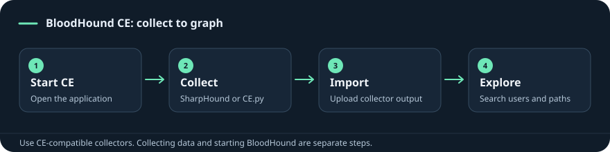

{/* VAULT_TASK_FINDER_START */}

import { TargetContextBar } from "/snippets/target-context-bar.jsx";

<TargetContextBar />

{/* VAULT_TASK_FINDER_END */}

{/* Generated from Commands/bloodhound.md. Edit the Markdown source, then run scripts/sync_site.py. */}

Replace UPPER_CASE values with your lab values.

[Search this tool’s saved examples](/commands/notebook?tool=bloodhound) · [All tools](/index) · [Ports](/enumeration/ports-cheatsheet)

## Start the configured Kali BloodHound package

**Run in:** Kali. **Requires:** The Kali package providing this helper, completed initial setup, and access to its configured local services.

```bash
sudo bloodhound-start
```

**What the result establishes:** Use object names, collection time and edge details to form a path from the identity you control to a specific resource.

**Next check:** Confirm the running generation and import a matching collector archive; check collection time and scope before querying paths.

## Stop

**Kali**

```bash
sudo bloodhound-stop
```

## Collect from Kali

**Kali**

```bash
bloodhound-ce-python -u 'USER' -d 'DOMAIN' -ns DC_IP -dc DC_FQDN -c DCOnly --zip
```

Password is prompted. Upload the resulting ZIP using Quick Upload in BloodHound.

## If it fails

| Symptom | Check |
| --- | --- |
| The UI opens but collection data is missing | A graph path is a hypothesis; stale data, incomplete collection, nested rights and session visibility can change whether an edge is usable. |
| Upload rejected | Use a collector compatible with the BloodHound generation you started. The legacy Python collector and CE collector are different; follow the CE collection sheet for CE. |

## Visual workflow



## Notebook recipes

11 additional examples, grouped by task. Saved as written; prompts, output, original lab values and older syntax may be included.

<AccordionGroup>

<Accordion title="Quick Recall">

### Quick Recall

**Active Directory ACL Abuse Primer**

```text
ACL                 List of permissions on an object
ACE                 One permission entry inside an ACL
DACL                Allows or denies access
SACL                Controls auditing
ForceChangePassword Reset a user's password
Add Members         Add accounts to a group
GenericWrite        Modify non-protected attributes
GenericAll          Full control over an object
WriteOwner          Change object ownership
WriteDACL           Modify object permissions
AddSelf             Add yourself to an allowed group
BloodHound          Visualize ACL relationships
PowerView           Enumerate and test AD permissions
Main outcomes       Lateral movement, privilege escalation, persistence
```

{/* VAULT_ORIGINAL_LINK_START */}

**Original note sections:** [Active Directory ACL Abuse Primer — Quick Recall](/active-directory/acl-primer#quick-recall)

{/* VAULT_ORIGINAL_LINK_END */}


</Accordion>

<Accordion title="🗺️ The kill chain (this assessment)">

### 🗺️ The kill chain (this assessment)

**Active Directory Attack Path: Worked Lab**

```text
OSINT (Betty Jayde)
   ↓  namebuster  → username list
Password spraying (Hydra, SSH)
   ↓  jbetty : Texas123!@#
SSH foothold (DMZ01)
   ↓  chisel / ligolo pivot into 172.16.119.0/24
Credential discovery (.bash_history)
   ↓  hwilliam : dealer-screwed-gym1
SMB share looting (FILE01)
   ↓  Employee-Passwords_OLD.psafe3
Crack the vault (pwsafe2john + john)
   ↓  bdavid, stom (OLD), hwilliam
BloodHound → bdavid = local admin on JUMP01 ; stom ∈ Domain Admins
   ↓
RDP to JUMP01 as bdavid (local admin)
   ↓  SeImpersonate → SYSTEM  (PrintSpoofer / GodPotato)
Mimikatz → LSASS → stom's CURRENT password
   ↓  stom : calves-warp-learning1  (Domain Admin)
DCSync against DC01
   ↓  Administrator NTLM + krbtgt
FULL DOMAIN COMPROMISE
```

{/* VAULT_ORIGINAL_LINK_START */}

**Original note sections:** [Active Directory Attack Path: Worked Lab — 🗺️ The kill chain (this assessment)](/cheatsheets/ad-attack-path-worked-example#-the-kill-chain-this-assessment)

{/* VAULT_ORIGINAL_LINK_END */}


</Accordion>

<Accordion title="Bloodhound">

### Bloodhound

**Active Directory Enumeration Commands**

```text
bloodhound-python -u '<USER>' -p '<PASSWORD>' -d <DOMAIN> -dc <DC_FQDN> -ns <DC_IP> -c All
    # Collect AD relationship data for BloodHound

Useful BloodHound relationships to look for:

MemberOf
    # Group membership

AdminTo
    # User/group has administrative access to a computer

GenericAll
    # Full control over an object

GenericWrite
    # Write permissions over an object

WriteDACL
    # Can modify an object's permissions

WriteOwner
    # Can change object ownership

ForceChangePassword
    # Can change another user's password

AddMember
    # Can add a principal to a group

CanRDP
    # Can use Remote Desktop

CanPSRemote
    # Can use PowerShell Remoting / WinRM

AllowedToDelegate
    # Delegation relationship
```

{/* VAULT_ORIGINAL_LINK_START */}

**Original note sections:** [Active Directory Enumeration Commands — Bloodhound](/active-directory/command-reference#bloodhound)

{/* VAULT_ORIGINAL_LINK_END */}


</Accordion>

<Accordion title="Collect from Kali">

### Collect from Kali

**BloodHound — Start, Collect, and Import**

```bash
bloodhound-ce-python \
  -u 'USERNAME' \
  -d 'AD_DOMAIN' \
  -ns 'DC_IP' \
  -dc 'DC_FQDN' \
  -c DCOnly \
  --zip
```

{/* VAULT_ORIGINAL_LINK_START */}

**Original note sections:** [BloodHound — Start, Collect, and Import — Collect from Kali](/tools/bloodhound#collect-from-kali)

{/* VAULT_ORIGINAL_LINK_END */}


</Accordion>

<Accordion title="Collect the directory baseline">

### Collect the directory baseline

**BloodHound — Start, Collect, and Import**

```bash
bloodhound-ce-python -u USERNAME -d DOMAIN_FQDN -ns DC_IP -dc DC_FQDN -c DCOnly --zip
```

{/* VAULT_ORIGINAL_LINK_START */}

**Original note sections:** [BloodHound — Start, Collect, and Import — Collect the directory baseline](/tools/bloodhound#collect-the-directory-baseline)

{/* VAULT_ORIGINAL_LINK_END */}


**BloodHound — Start, Collect, and Import**

```bash
bloodhound-ce-python -u USERNAME -d DOMAIN_FQDN -ns DC_IP -dc DC_FQDN -c All --zip
```

{/* VAULT_ORIGINAL_LINK_START */}

**Original note sections:** [BloodHound — Start, Collect, and Import — Collect the directory baseline](/tools/bloodhound#collect-the-directory-baseline)

{/* VAULT_ORIGINAL_LINK_END */}


</Accordion>

<Accordion title="Start the application separately from collection">

### Start the application separately from collection

**BloodHound — Start, Collect, and Import**

```bash
# Kali packaging that provides this launcher:
sudo bloodhound-start
```

{/* VAULT_ORIGINAL_LINK_START */}

**Original note sections:** [BloodHound — Start, Collect, and Import — Start the application separately from collection](/tools/bloodhound#start-the-application-separately-from-collection)

{/* VAULT_ORIGINAL_LINK_END */}


</Accordion>

<Accordion title="Stop or restart">

### Stop or restart

**BloodHound — Start, Collect, and Import**

```bash
# Stop the Kali package
sudo bloodhound-stop

# Start it again
sudo bloodhound-start
```

{/* VAULT_ORIGINAL_LINK_START */}

**Original note sections:** [BloodHound — Start, Collect, and Import — Stop or restart](/tools/bloodhound#stop-or-restart)

{/* VAULT_ORIGINAL_LINK_END */}


</Accordion>

<Accordion title="Work outward from the controlled identity">

### Work outward from the controlled identity

**BloodHound — Start, Collect, and Import**

```powershell
Get-ADPrincipalGroupMembership USERNAME | Select-Object Name
Get-ADGroupMember GROUP_NAME -Recursive
whoami /groups
```

{/* VAULT_ORIGINAL_LINK_START */}

**Original note sections:** [BloodHound — Start, Collect, and Import — Work outward from the controlled identity](/tools/bloodhound#work-outward-from-the-controlled-identity)

{/* VAULT_ORIGINAL_LINK_END */}


</Accordion>

<Accordion title="Overview">

### Overview

**Ligolo-ng Setup and BloodHound Collection**

```text
Kali: proxy + TUN interface + BloodHound CE
              ▲
              │ reverse TLS connection
              │
Target: agent ─┴─ internal AD network
```

{/* VAULT_ORIGINAL_LINK_START */}

**Original note sections:** [Ligolo-ng Setup and BloodHound Collection — Overview](/pivoting/ligolo-bloodhound-setup#overview)

{/* VAULT_ORIGINAL_LINK_END */}


</Accordion>

<Accordion title="Legacy BloodHound (neo4j + Electron)">

### Legacy BloodHound (neo4j + Electron)

**BloodHound: Full Reference · older reference**

```bash
sudo apt install -y bloodhound neo4j
sudo neo4j start                       # browse http://localhost:7474, login neo4j/neo4j, set new pw
bloodhound &                           # GUI: connect bolt://localhost:7687 with neo4j creds
```

{/* VAULT_ORIGINAL_LINK_START */}

**Original note sections:** [BloodHound: Full Reference — Legacy BloodHound (neo4j + Electron)](/cheatsheets/bloodhound-complete-guide#legacy-bloodhound-neo4j-+-electron)

{/* VAULT_ORIGINAL_LINK_END */}


</Accordion>

</AccordionGroup>

## Related tools and references

- [Official documentation 1](https://www.kali.org/tools/bloodhound/)

{/* VAULT_RELATED_START */}

**Source material and related references**

- [BloodHound — Start, Collect, and Import](/tools/bloodhound)

{/* VAULT_RELATED_END */}
