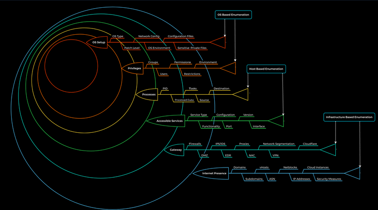
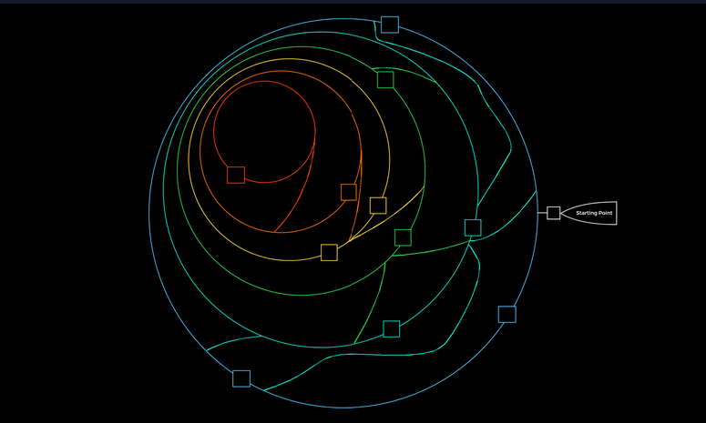

{/* Generated from Reconnaissance/Layers_enumeration.md. Edit the Markdown source, then run scripts/sync_site.py. */}

## Turn each discovery into the next enumeration question

Start with the authorized address/domain scope and your network position. Reconnaissance is a sequence of narrowing questions: which hosts respond, which services are exposed, what names/applications they represent, which identities are accepted, and what those identities can access. Keep negative results with the method used; ICMP silence and a failed HTTP request answer different questions.

### Host and service layer

```bash
ip -br addr
ip route get TARGET_IP
nmap -sn LAB_SUBNET -oA discovery
nmap -sT -Pn -n -p 21,22,25,53,80,110,139,143,443,445,1433,3306,3389,5985 TARGET_IP -oA initial-services
```

The port list is an initial triage set, not a complete scan. Follow it with full TCP coverage and targeted UDP checks when the lab permits. Preserve the selected source interface and any tunnel/proxy constraints.

```bash
nmap -sT -Pn -n -p- TARGET_IP -oA all-tcp
nmap -sV -sC -Pn -p OPEN_PORTS TARGET_IP -oA service-detail
```

### Names and application layer

```bash
dig @DNS_IP DOMAIN_FQDN SOA
dig @DNS_IP DOMAIN_FQDN MX
curl -I http://TARGET_IP/
curl -H 'Host: APP_FQDN' http://TARGET_IP/
```

A port may host multiple virtual applications. Collect certificate names, redirects, hostnames, domain suffixes and service banners. A version string is a lead for verification, not proof that the installed package is vulnerable.

### Choose the protocol-specific branch

| Evidence | Follow-up |
| --- | --- |
| SMB/RPC | Domain/host identity, signing, accessible shares, users/groups and per-share permissions |
| LDAP/Kerberos | Domain/DC/DNS context, bind identity, account/group/object relationships |
| HTTP/HTTPS | Virtual hosts, routes, parameters, authentication, roles and application behavior |
| SQL service | Authentication mode, database identity, schema permissions and linked services |
| NFS/FTP/rsync | Exports/modules/directories, anonymous/authenticated access and selected readable files |
| SMTP/IMAP/POP3 | TLS, authentication mechanism, mail domain and protocol-specific enumeration |
| SNMP/IPMI | Valid protocol configuration, readable management data and actual device/service identity |
| SSH/RDP/WinRM | Reachability, accepted identity and permitted session/logon type |

### Convert a finding into a hypothesis

Write one sentence: “This identity can read this configuration, which may contain a credential for this service.” Then test that exact relationship. Do not jump from “port open” to “run an exploit” or from “user exists” to “administrator.” After gaining a new credential, shell or network position, repeat the relevant enumeration from that new context.

## Existing notes and worked examples
> **What this diagram shows**
> "Layers of enumeration" — widening rings of scope as an engagement progresses: **OS-based** (OS type/patch level, config files, sensitive files) → **Host-based** (privileges/groups, running processes, accessible services) → **Infrastructure-based** (gateway: firewalls/IDS-IPS/proxies/segmentation, and internet presence: domains/vhosts/netblocks/ASN/cloud). Useful as a mental checklist so recon doesn't stop at the first host. Ties into [Footprinting Lab Methodology Cheat Sheet](/enumeration/footprinting-lab-methodology-cheat-sheet) (per-service depth) and [DNS & Web Recon Cheat Sheet](/recon/dns-web-recon-cheat-sheet) (the internet-presence ring).


enumeration labyrinth
