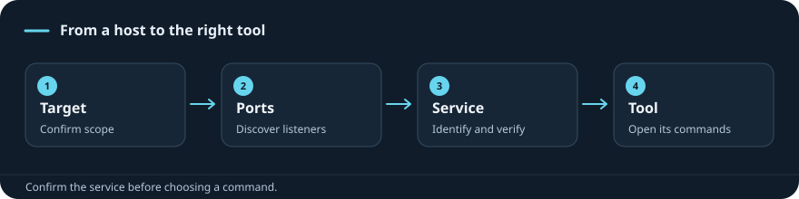

{/* VAULT_ENTRY_POINTS_START */}

## Choose your starting point

<CardGroup cols={2}>
<Card title="IP only" href="/enumeration/methodology#1-establish-your-route-and-record-the-scan">
Start with reachability and a recorded TCP scan.
</Card>
<Card title="Open ports" href="/enumeration/methodology#2-choose-the-branch-from-the-actual-service">
Identify the actual service and select its next check.
</Card>
<Card title="Identified service" href="/enumeration/methodology#2-choose-the-branch-from-the-actual-service">
Choose a protocol-specific enumeration branch.
</Card>
<Card title="Service credentials" href="/enumeration/methodology#3-establish-smb-authentication-separately-from-share-access">
Separate a successful login from resource permissions.
</Card>
</CardGroup>

{/* VAULT_ENTRY_POINTS_END */}

{/* Generated from Subjects/recon.md. Edit the Markdown source, then run scripts/sync_site.py. */}

[Search commands](/index) · [Browse every saved Recon & Services example](/commands/notebook?subject=recon)

## Choose the task

<CardGroup cols={2}>

<Card title="Find a port or service" href="/enumeration/ports-cheatsheet">

Port numbers are clues; confirm the actual service.

</Card>

<Card title="Scan a host" href="/commands/nmap">

Record scan output and distinguish filtered from closed ports.

</Card>

<Card title="SMB shares" href="/commands/smbclient">

A valid login and access to a specific share are separate checks.

</Card>

<Card title="Resolve a Windows host" href="/commands/resolve-dnsname">

Use the domain DNS server when necessary.

</Card>

<Card title="MSSQL login and queries" href="/commands/mssqlclient">

Choose SQL authentication or Windows authentication.

</Card>

<Card title="MySQL / MariaDB" href="/commands/mysql">

Confirm the instance, port, and account.

</Card>

<Card title="RPC users and groups" href="/commands/rpcclient">

Anonymous, guest and authenticated sessions differ.

</Card>

<Card title="FTP / NFS / SNMP / email" href="/tools/index">

Choose the service section before choosing a tool.

</Card>

</CardGroup>
## Tools in this subject

- [arp](/commands/arp)
- [dig](/commands/dig)
- [dnsenum](/commands/dnsenum)
- [dnsrecon](/commands/dnsrecon)
- [fping](/commands/fping)
- [ftp](/commands/ftp)
- [Get-NetIPConfiguration](/commands/get-netipconfiguration)
- [Hydra](/commands/hydra)
- [ip](/commands/ip)
- [ipconfig](/commands/ipconfig)
- [Medusa](/commands/medusa)
- [mount](/commands/mount)
- [mssqlclient.py](/commands/mssqlclient)
- [mysql](/commands/mysql)
- [netstat](/commands/netstat)
- [Nmap](/commands/nmap)
- [nslookup](/commands/nslookup)
- [ODAT](/commands/odat)
- [onesixtyone](/commands/onesixtyone)
- [openssl](/commands/openssl)
- [ping](/commands/ping)
- [rdp-sec-check.pl](/commands/rdp-sec-check)
- [Resolve-DnsName](/commands/resolve-dnsname)
- [route](/commands/route)
- [rpcdump.py](/commands/rpcdump)
- [rsync](/commands/rsync)
- [samrdump.py](/commands/samrdump)
- [showmount](/commands/showmount)
- [smtp-user-enum](/commands/smtp-user-enum)
- [snmpwalk](/commands/snmpwalk)
- [sqlcmd](/commands/sqlcmd)
- [sqlplus](/commands/sqlplus)
- [ss](/commands/ss)
- [ssh-audit.py](/commands/ssh-audit)
- [swaks](/commands/swaks)
- [telnet](/commands/telnet)
- [Test-NetConnection](/commands/test-netconnection)
- [traceroute](/commands/traceroute)

## Detailed notes

Use the subject sidebar for the full lessons. Your original lab examples are preserved; a reference being present does not mark its module complete.

{/* VAULT_RELATED_START */}

**Full notes and related references**

- [Common Services module index](/modules/attacking-common-services) — Choose the focused service chapters or the complete saved module.
- [Common Services personal assessment](/modules/common-services/assessment) — Revisit the original lab sequence, terminology corrections and troubleshooting observations.
- [Complete Common Services reference](/modules/common-services/full-reference) — Read the full saved material, including the opening FTP and SMB topics.
- [Protocol and service reference](/reference/master-protocol-service-quick-reference) — Compare service purposes and return to their complete notes.
- [Recon & Services: Enumeration Methodology](/enumeration/methodology) — Where to start, what to enumerate, and how to choose the next check.

{/* VAULT_RELATED_END */}
