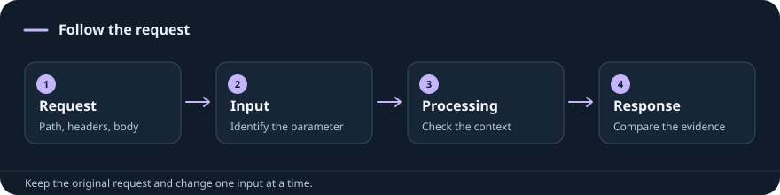

{/* VAULT_ENTRY_POINTS_START */}

## Choose your starting point

<CardGroup cols={2}>
<Card title="Unauthenticated application" href="/web/methodology#1-confirm-which-application-you-are-visiting">
Confirm hostnames, redirects, and the normal response.
</Card>
<Card title="Authenticated session" href="/web/methodology#2-capture-a-normal-request-with-the-correct-identity">
Capture a working request with the right account and tokens.
</Card>
<Card title="Interesting input" href="/web/methodology#follow-the-observed-behavior">
Choose checks from the observed processing behavior.
</Card>
<Card title="Upload feature" href="/web/methodology#3-change-one-upload-property-at-a-time">
Vary one property, then follow storage and retrieval.
</Card>
</CardGroup>

{/* VAULT_ENTRY_POINTS_END */}

{/* Generated from Subjects/web.md. Edit the Markdown source, then run scripts/sync_site.py. */}

[Search commands](/index) · [Browse every saved Web example](/commands/notebook?subject=web)

## Choose the task

<CardGroup cols={2}>

<Card title="Directories and virtual hosts" href="/commands/ffuf">

Set a baseline and filter by evidence, not only status code.

</Card>

<Card title="SQL injection" href="/web/sqli">

Confirm the injection context and database before selecting syntax.

</Card>

<Card title="Saved request in sqlmap" href="/commands/sqlmap">

Preserve authentication, CSRF and the intended parameter.

</Card>

<Card title="File upload" href="/web/file-upload">

Storage path, extension handling and execution are different questions.

</Card>

<Card title="Command injection" href="/web/cmdi">

Check the OS, shell and quoting context.

</Card>

<Card title="LFI / RFI" href="/web/lfi-rfi">

Read versus include behavior and path handling matter.

</Card>

<Card title="SSRF" href="/web/ssrf">

Prove the server made the request; note allowed schemes and destinations.

</Card>

<Card title="XSS" href="/web/xss">

Identify the browser context and encoding.

</Card>

<Card title="Authentication / authorization" href="/web/auth-bypass">

Test session identity and access to the specific object.

</Card>

<Card title="Template injection" href="/field/ssti">

Confirm server-side evaluation and identify the engine.

</Card>

<Card title="SSI directives" href="/field/ssi">

The response must be processed for SSI.

</Card>

<Card title="XSLT" href="/field/xslt">

Processor, version, and namespace determine valid tests.

</Card>

<Card title="API credentials" href="/field/api-credentials">

Verify the issuer, lab endpoint and scope.

</Card>

</CardGroup>
## Tools in this subject

- [CeWL](/commands/cewl)
- [ffuf](/commands/ffuf)
- [FinalRecon](/commands/finalrecon)
- [Gobuster](/commands/gobuster)
- [Nikto](/commands/nikto)
- [sqlmap](/commands/sqlmap)
- [subbrute.py](/commands/subbrute)
- [subfinder](/commands/subfinder)
- [theHarvester](/commands/theharvester)
- [WhatWeb](/commands/whatweb)

## Detailed notes

Use the subject sidebar for the full lessons. Your original lab examples are preserved; a reference being present does not mark its module complete.

{/* VAULT_RELATED_START */}

**Full notes and related references**

- [Web study reference](/web/index) — Open the broader web workflow and its original explanations.
- [Web enumeration reference](/web/web-enumeration) — Use the saved enumeration reference alongside the individual tool sheets.
- [Service and web assessment observations](/modules/common-services/assessment) — Find the saved distinctions between file upload, database access and code execution.
- [Web: Enumeration Methodology](/web/methodology) — Where to start, what to enumerate, and how to choose the next check.
- [Six full HTB web modules](/web/htb/index) — Read the supplied lessons alongside the existing quick references.

{/* VAULT_RELATED_END */}
